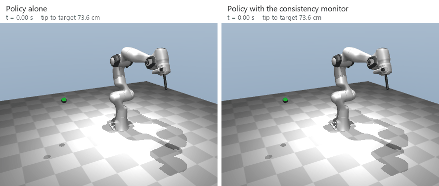
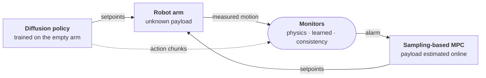
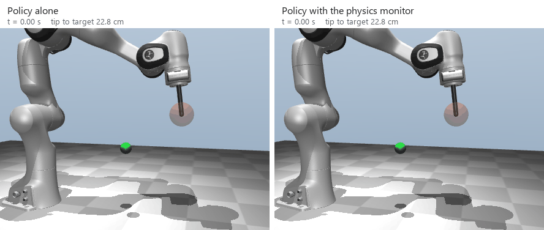

# Learning-Assisted Control under Unknown Payloads

A simulation study in MuJoCo. A robot arm holds a payload of unknown mass. The controller's model is then wrong, and an imitation policy that was trained on the empty arm does not reach its targets. This study measures what can correct the model, what can detect the failure, and what can recover from it.



*A Franka Panda reaches for a target outside the region of its training data (green sphere). Left: the policy alone stops 13 cm from the target. Right: the consistency monitor gives an alarm at 0.40 s, the MPC takes control, and the tip stops 0.1 cm from the target. This is a typical test run, not the best one.*

## Contents

The study has three parts. Each part uses the results of the part before it.

| Part | Question | Platform |
|---|---|---|
| I | After the payload changes, how do we correct the controller's model: estimate the payload mass, train a neural network on the model error, or both? What occurs when the controller uses a learned model outside its training data? | Two-link arm, sampling-based MPC |
| II | A diffusion policy controls the arm. Which model must a monitor use to detect a failure: a physics model, or a learned model? When must the monitor give control to the MPC? | Two-link arm, closed-form diffusion policy (CFDP) |
| III | Are the results of Parts I and II also true for a 7-joint arm with joint impedance control, at two joint stiffnesses? | Franka Panda from MuJoCo Menagerie |

## System

In Parts II and III, the policy controls the arm. Monitors look at the motion of the arm and at the policy's actions. When a monitor gives an alarm, the MPC takes control and estimates the payload mass from the data of the run.



There are three monitors:

- The **physics monitor** compares the measured motion with the motion that a model of the empty arm predicts.
- The **learned monitor** does the same, but it adds a neural network that learned the model error from the training demonstrations.
- The **consistency monitor** does not use a model. It compares two overlapping action chunks of the policy. A large difference shows that the policy is uncertain.

Each monitor adds its signal over time (CUSUM). Its alarm threshold comes from 100 calibration runs without a fault, for a false-alarm rate of 5% (split-conformal calibration).

## Results


*Franka Panda. Each bar shows 96 runs: 16 tasks, 3 model errors, 2 joint stiffnesses. A run fails if the tip is not within 1 cm of the target after 3 s.*



*The same arm with a 2.5 kg payload, target inside the training region. Left: the policy alone stops 7.3 cm below the target. Right: the physics monitor gives an alarm at 0.08 s, and the MPC takes control.*

### Part I: correct the model (two-link arm)

1. The quantity of data decides the best method. With 9 s of motion data, the mass estimate is more accurate than a learned model. With 30 s or more, the physics model plus a learned correction is the most accurate inside the training region: the final error is 0.07 cm, and 1.95 cm with the mass estimate only.
2. Outside the training region, the MPC finds and uses the errors of the learned model. Along the paths that the MPC selects, the one-step prediction error increases by 8 to 13 times. The worst runs stop 50 to 66 cm from the target. An ensemble of five networks decreases these failures.

### Part II: monitor the policy (two-link arm)

3. A policy that was trained on the empty arm fails with a 1 kg payload: the median error increases from 0.4 cm to 2 cm. The policy itself shows little of the failure. Its action chunks mostly stay consistent while the arm moves down under the load: the consistency monitor detects only 25% to 44% of these runs.
4. The two types of monitor detect two different failures. The residual monitors detect the payload: when the model has no friction error, they detect every run from 0.05 kg. Only the consistency monitor detects that the policy is outside its training region (94% of runs). When the physics model does not know the joint friction, the learned monitor detects smaller payloads than the physics monitor.

### Part III: the Franka Panda

5. The results of Part II are also true on the Panda. With a 2.5 kg payload, a handover from a residual monitor recovers all runs. The final error is within 0.04 cm of an MPC that estimates the payload from the start. Outside the training region, only the consistency monitor recovers the policy.
6. On the Panda, a learned model is of little use for control. The joint impedance loop removes most of the model error, so a learned model can decrease the final error by 3.5 mm at most. But the learned model is useful for monitoring. When the physics model does not know the friction, the learned monitor gives the alarm after 0.2 s, and the physics monitor after 1.6 s.
7. The monitors do not detect all failures. In one run outside the training region, the policy stops 20 cm from the target, but its action chunks stay consistent. No monitor gives an alarm. Also, a handover helps only when the MPC that takes control is better than the policy.

## Method of the comparison

- **Expected results first.** For Parts II and III, the expected results were written and committed before each test run (26 statements). The results are reported against these statements. Some statements were wrong, and the report shows this.
- **Known model errors only.** When the controller's model knows the true payload and friction, it gives the same motion as the simulator, step by step (difference of approximately 1e-16). Thus each remaining error comes from one of three model errors that we set: payload mass only (W1), mass and centre-of-mass offset (W2), or mass, offset and joint friction (W3).
- **Settings fixed before the tests.** The MPC, network, ensemble and policy settings were selected on development tasks. They did not change for the test runs.
- **Separate data.** Test tasks have their own random seeds, inside and outside the training region. The data is divided by complete episodes, not by time steps.

<details>
<summary>Methods</summary>

| Name | Model or policy that the controller uses | Part |
|---|---|---|
| C0 | Physics model of the empty arm | I, III |
| C1 | Physics model, with the payload mass from a least-squares estimate | I, III |
| C2, C3 | C0, C1 plus a neural network that learned the model error | I |
| C2-E, C3-E | C2, C3 with the mean of an ensemble of five networks | I |
| Reference | Physics model that knows the true payload and friction. This is a limit, not a method | I, II, III |
| CFDP | Closed-form diffusion policy. It copies the reference MPC on the empty arm | II, III |
| Diffusion Policy | Standard CNN Diffusion Policy (Chi et al., 2023), as a second policy | II |
| Physics, learned, oracle monitor | Residual of a model of the empty arm: without friction, with a learned correction, with the true friction | II, III |
| Consistency monitor | Difference between overlapping action chunks | II, III |
| Handover | The policy controls the arm until a monitor gives an alarm. Then the MPC controls the arm, with the payload estimated from the run | II, III |

</details>

<details>
<summary>Repository</summary>

```
src/lac/                 the package
  arm.py, model.py         two-link arm (MuJoCo), its three model errors, hand-written dynamics
  mpc.py, predictors.py    sampling-based MPC (path-integral weighting) and its predictors
  estimate.py, learned.py  least-squares payload estimate; residual networks and ensembles
  demos.py, policy.py      expert demonstrations; CFDP and nearest-neighbour policies
  diffusion.py             standard Diffusion Policy (1-D conditional U-Net, DDIM sampling)
  monitor.py, handover.py  residual and consistency monitors, CUSUM, conformal thresholds, handover
  panda*.py                the same parts for the Franka Panda, and its interactive viewer
experiments/             one script for each stage; each script writes tables and figures to results/
results/                 tables and figures of each stage
report/                  report source, figure and video scripts
third_party/             Franka Panda model from MuJoCo Menagerie (Apache-2.0)
tests/                   131 tests, including a term-by-term comparison of the models with the simulator
reproduce.py             runs all stages in sequence
```

</details>

## Installation and use

We used Python 3.11 on Windows. Other platforms are possible, but we did not test them.

```bash
python -m venv .venv
.venv\Scripts\python -m pip install torch --index-url https://download.pytorch.org/whl/cpu
.venv\Scripts\python -m pip install -e ".[dev,report]"
.venv\Scripts\python -m pytest -q
```

To see the Panda live, run the command below. Use `[` and `]` to change the controller (C0, C1, reference), `,` and `.` to change the payload, and Enter for the next task.

```bash
.venv\Scripts\python -m lac.panda_view --world W2 --payload 2.5
```

To see the two-link arm in an interactive panel:

```bash
.venv\Scripts\python -m lac.view --world W2 --payload 1 --method 3
```

To make all results, figures, the report and the video again, run the command below. This takes 6 to 7 hours on an 8-core laptop CPU. `--list` shows the steps. `--outputs-only` makes only the figures, report and video from the saved results.

```bash
.venv\Scripts\python reproduce.py
```

The [report](report/main.pdf) (5 pages) and the [demo video](report/demo.mp4) cover Part I.

## Limitations

- All results come from simulation.
- All tasks are reaching tasks. For these tasks, an MPC with an online payload estimate is as good as the best handover. Thus the policy is not necessary here. The study only asks if monitors and handover can recover a policy that fails.
- The payload is on the arm from the start of each run. The arm does not pick it up.
- "Outside the training region" is one region of the workspace.
- We selected the model errors W2 and W3 by hand.
- The ensemble MPC and CFDP are too slow for real-time use in this implementation: approximately 28 ms and 140 ms, against limits of 20 ms and 80 ms.

## Acknowledgements

The Franka Emika Panda model is from [MuJoCo Menagerie](https://github.com/google-deepmind/mujoco_menagerie) (Apache-2.0, see `third_party/`). The simulator is [MuJoCo](https://mujoco.org). The Diffusion Policy implementation follows Chi et al., *Diffusion Policy: Visuomotor Policy Learning via Action Diffusion* (RSS 2023).

## Author

Shengwei Li, The University of Sydney.
