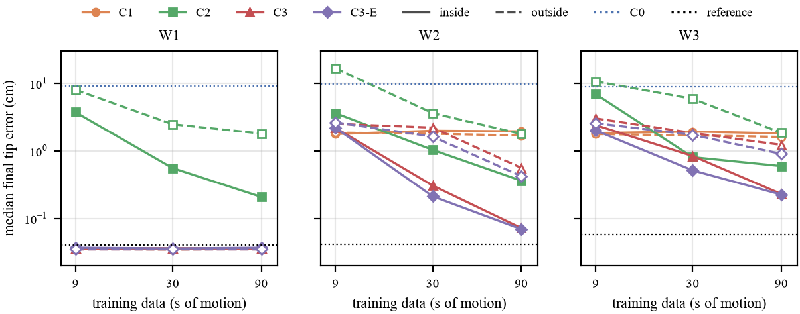

# Physics, Learning, or Both? Correcting a Sampling-Based MPC after an Unknown Payload Change

A controlled simulation study of how to repair a model-based controller after a robot arm picks up an unknown payload: estimate a physical parameter, learn the model's error with a neural network, or both, and what happens when the learned model is used outside the data it was trained on.

**Report:** [`report/main.pdf`](report/main.pdf) (5 pages) · **Demo video:** [`report/demo.mp4`](report/demo.mp4) (55 s)



## Question

A sampling-based model predictive controller (MPC) reaches targets with a two-link arm. After a 1 kg payload of unknown mass is attached, its internal model is wrong. From a few seconds of recorded motion, the model can be corrected by

| Method | Model used by the MPC |
|---|---|
| C0 | physics, assuming no payload (no correction) |
| C1 | physics, with the payload mass estimated by least squares |
| C2 | C0's physics plus a neural network trained on its residual |
| C3 | C1's physics plus a neural network trained on its residual |
| C2-E, C3-E | as C2, C3, averaging an ensemble of five networks |
| Reference | physics told the true payload (an upper bound, not a method) |

All methods share one MPC with identical settings; only the predictor changes. The real arm differs from the controller's model in one of three ways: only the payload mass (W1), plus an offset of the payload's centre of mass (W2), plus unmodelled joint friction (W3).

## Findings

In this setting (simulation only, one planar arm, one payload mass):

1. **Data decides the winner.** With 9 s of motion, estimating the mass (C1) is more accurate than learning; with 30 s or more, learning wins inside the region where data was collected, and physics plus learning (C3) is best: 0.07 cm final error in W2 with 90 s of data, against 1.95 cm for C1 and 0.04 cm for the exact reference.
2. **Outside the training region, the controller exploits the learned model's errors.** Along the path the MPC chooses, the learned models' one-step prediction error grows 8 to 13 times, most of the learned advantage disappears, and the worst runs end 50 to 66 cm from the target.
3. **Every wrong model is exploited the same way.** The MPC's expected outcome is optimistic by half to all of the model's prediction error, for physics and learned models alike; learned models outside their data give it more error to exploit.
4. **Averaging an ensemble cuts the worst failures**, making physics plus learning the most robust option outside the training region given enough data. It does not help with too little data, a penalty on ensemble disagreement added nothing measurable, and the ensemble planner needs about 28 ms per 20 ms control period on the laptop CPU used.

## Repository

```
src/lac/            the package
  arm.py              the simulated arm (MuJoCo), its three worlds and friction
  model.py            the controller's hand-written two-link dynamics, verified against the simulator
  predictors.py       physics predictor handed to the MPC
  mpc.py              sampling-based MPC (path-integral weighting)
  control.py          inverse kinematics and PD control (early baselines)
  data.py             motion data collection, episode-wise splits, prediction metrics
  estimate.py         least-squares payload-mass estimate (C1)
  learned.py          residual networks (PyTorch training, NumPy inference) and ensembles
  methods.py          assembles the methods from data and cached networks; test tasks
  view.py             interactive panel
experiments/        one script per stage, each writing a table and figures to results/
report/             report source, figure and table scripts, demo video script
tests/              73 checks, including the model against the simulator term by term
reproduce.py        re-runs everything in order
```

## Running it

Python 3.11 on Windows was used; other platforms should work but were not tested.

```bash
python -m venv .venv
.venv\Scripts\python -m pip install torch --index-url https://download.pytorch.org/whl/cpu
.venv\Scripts\python -m pip install -e ".[dev,report]"
.venv\Scripts\python -m pytest -q
```

Interactive panel (pose the arm, change the payload, compare controllers live):

```bash
.venv\Scripts\python -m lac.view --world W2 --payload 1 --method 3
```

Reproduce all results, figures, report and video (roughly 1.5 to 2 hours; `--list` shows the steps, `--outputs-only` rebuilds only the figures, tables, report and video from saved results):

```bash
.venv\Scripts\python reproduce.py
```

## How the comparison was kept fair

- The controller's model is written by hand and checked against the simulator's inertia matrix and bias forces; with the true parameters it reproduces the simulator step for step, so every remaining error is attributable.
- Every choice (MPC settings, network size and training, ensemble penalty) was made on development data and development tasks only, then frozen.
- Test results use separate data seeds and 8 new tasks inside and 8 outside the training region; 24 runs per method, world and data budget.
- Data is split by whole episodes, never by individual time steps.
- Re-running the inside tasks in a later experiment reproduced all 792 earlier runs exactly.

## Limitations

Simulation only; a planar two-link arm; one payload mass; "outside" is one region of the workspace; ensemble members differ only in their initialisation; the model mismatches in W2 and W3 were chosen by hand; the ensemble controller does not run in real time as implemented.

## Author

Shengwei Li, The University of Sydney.
