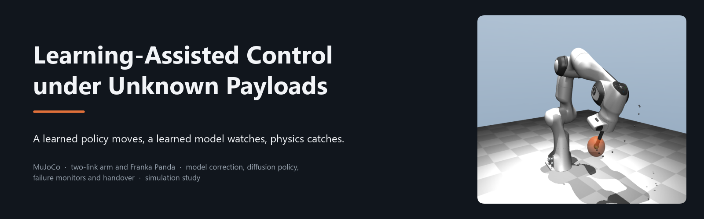
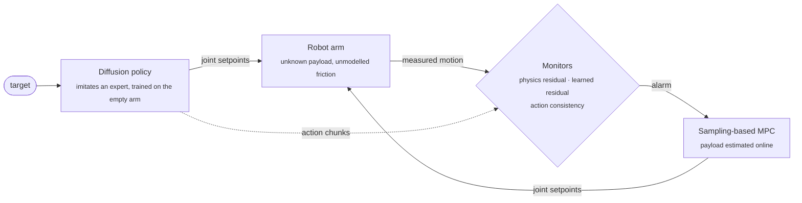
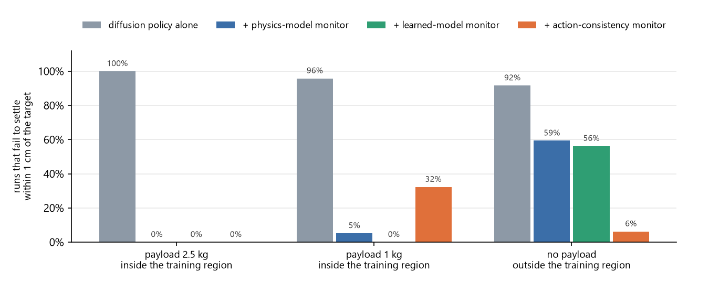

<p align="center">
  
</p>

<p align="center">
  
  
  
  
  
</p>

<p align="center">
  <a href="#results-at-a-glance">Results</a> ·
  <a href="#how-it-fits-together">Design</a> ·
  <a href="#getting-started">Getting started</a> ·
  <a href="report/main.pdf">Report (Part I)</a> ·
  <a href="report/demo.mp4">Demo video</a>
</p>

---

A robot arm picks up something of unknown weight. Its controller's model is now wrong, and an imitation policy trained on the empty arm no longer reaches its targets. This project is a controlled simulation study of what to do about it, in three parts:

| | Question | Platform |
|---|---|---|
| **I. Correct the model** | Estimate the payload, learn the model's error with a neural network, or both? What happens when the controller uses a learned model outside its data? | two-link arm, sampling-based MPC |
| **II. Watch the policy** | Which model should a monitor use to notice that a diffusion policy is failing: a coarse but trusted physics model, or an accurate learned one? And when should it hand over? | two-link arm, closed-form diffusion policy |
| **III. Scale it up** | Do the conclusions survive a 7-DoF Franka Panda with joint impedance control, at two joint stiffnesses? | Franka Panda (MuJoCo Menagerie) |

## How it fits together

> **A learned policy moves, a learned model watches, physics catches.**



Each monitor turns one signal into a score with CUSUM accumulation and sets its threshold by split-conformal calibration on clean runs, for a 5% false-alarm rate. The residual monitors ask whether the arm still moves the way a model of the *empty* arm predicts; the consistency monitor asks whether the policy agrees with itself from one action chunk to the next.

## Results at a glance

<p align="center">
  
</p>

<p align="center"><sub>Franka Panda, 96 runs per bar (16 tasks × 3 worlds × 2 joint stiffnesses). Each monitor hands control to the MPC on its first alarm.</sub></p>

**Part I: correcting the model** (two-link arm)

1. **Data decides the winner.** With 9 s of motion, estimating the mass is more accurate than learning; with 30 s or more, physics plus a learned residual is best inside the training region: 0.07 cm final error, against 1.95 cm for the mass estimate alone.
2. **Outside its data, the controller exploits the learned model's errors.** Along the paths the MPC chooses, one-step prediction error grows 8 to 13 times and the worst runs end 50 to 66 cm from the target. An ensemble of five networks cuts these worst failures.

**Part II: watching the policy** (two-link arm)

3. **A policy taught on the empty arm fails under load,** and nothing inside the policy shows it: its action chunks stay consistent while the arm sags.
4. **The two kinds of monitor see two kinds of failure.** Model residuals catch the payload (every run from 0.05 kg where the model has no friction error); action consistency is the only signal that catches the policy leaving its training region (94% of runs). Where the physics model misses friction, a residual network learned from the same demonstrations restores most of the lost sensitivity.

**Part III: the Panda**

5. **The conclusions hold in 3-D, with one twist.** With a 2.5 kg payload, residual-triggered handover rescues every run, ending within 0.04 cm of an adaptive MPC; only consistency rescues the policy outside its region. But the Panda's stiff joint loop absorbs most model error, so a learned model is barely worth having *for control* (at most 3.5 mm better). Its value is *for monitoring*: with friction in the model's blind spot, the learned residual triggers handover after 0.2 s instead of 1.6 s.
6. **Detecting a failure is not the same as needing to hand over.** A policy can be confidently wrong (consistent, yet 20 cm away), which no monitor here sees; and handing over only helps when the controller taking over is better than the policy it replaces.

> [!NOTE]
> On these reaching tasks, an adaptive MPC on its own is as good as the best handover everywhere. The policy is not needed here; the study asks whether monitoring and handover can catch a policy's failures once one is used.

## How the comparison was kept fair

- **Expectations first.** In Parts II and III, the expected outcomes were written down and committed before each test run (26 in all); the results were then reported against them, including the ones that turned out wrong.
- **Attributable errors.** The controller's model reproduces the simulator step for step when told the truth (differences around 1e-16), so every remaining error comes from the deliberate mismatch: the payload's mass (W1), plus its centre-of-mass offset (W2), plus unmodelled joint friction (W3).
- **Frozen settings.** MPC settings, network sizes, ensemble penalty and policy settings were chosen on development tasks only, then frozen for all test runs.
- **Separate data.** Test tasks use their own seeds, inside and outside the training region; data are split by whole episodes, never by time step.

<details>
<summary><b>Methods compared</b></summary>

<br>

| Name | What the controller uses | Part |
|---|---|---|
| C0 | physics, assuming no payload | I, III |
| C1 | physics, with the payload mass estimated by least squares | I, III |
| C2 / C3 | C0 / C1 physics plus a residual network | I |
| C2-E / C3-E | as C2 / C3, averaging an ensemble of five networks | I |
| Reference | physics told the true payload and world (an upper bound, not a method) | I, II, III |
| CFDP | closed-form diffusion policy imitating the reference MPC on the empty arm | II, III |
| Diffusion Policy | the standard CNN-based Diffusion Policy (Chi et al., 2023), as a second policy | II |
| Physics / learned / oracle monitor | residual of a model of the empty arm: without friction / plus a residual network / told the friction | II, III |
| Consistency monitor | disagreement between overlapping action chunks | II, III |
| Handover | policy until a monitor alarms, then the MPC with the payload estimated from the run so far | II, III |

</details>

<details>
<summary><b>Repository layout</b></summary>

<br>

```
src/lac/                 the package
  arm.py, model.py         two-link arm (MuJoCo), its three worlds, hand-written dynamics
  mpc.py, predictors.py    sampling-based MPC (path-integral weighting) and its predictors
  estimate.py, learned.py  least-squares payload estimate; residual networks and ensembles
  demos.py, policy.py      expert demonstrations; CFDP and nearest-neighbour policies
  diffusion.py             standard Diffusion Policy (1-D conditional U-Net, DDIM sampling)
  monitor.py, handover.py  residual and consistency monitors, CUSUM, conformal thresholds, handover
  panda*.py                the same pieces on the Franka Panda, and its interactive viewer
experiments/             one script per stage, each writing tables and figures to results/
results/                 saved tables and figures for every stage
report/                  report source, figure and video scripts
third_party/             Franka Panda model from MuJoCo Menagerie (Apache-2.0)
tests/                   131 checks, including the models against the simulator term by term
reproduce.py             re-runs everything in order
```

</details>

## Getting started

Python 3.11 on Windows was used; other platforms should work but were not tested.

```bash
python -m venv .venv
.venv\Scripts\python -m pip install torch --index-url https://download.pytorch.org/whl/cpu
.venv\Scripts\python -m pip install -e ".[dev,report]"
.venv\Scripts\python -m pytest -q
```

Watch the Panda live: switch controllers (C0, C1, reference) with `[` `]`, change the payload with `,` `.`, next task with Enter.

```bash
.venv\Scripts\python -m lac.panda_view --world W2 --payload 2.5
```

Interactive panel for the two-link arm:

```bash
.venv\Scripts\python -m lac.view --world W2 --payload 1 --method 3
```

Reproduce every result, figure and the report. This takes about 6 to 7 hours on an 8-core laptop CPU; `--list` shows the steps, and `--outputs-only` rebuilds only the figures, report and video from saved results.

```bash
.venv\Scripts\python reproduce.py
```

## Limitations

Simulation only. Reaching tasks, where a hand-written cost already works, so a policy is not needed. One payload attached from the start of a run rather than picked up. "Outside" is one region of the workspace. The model mismatches in W2 and W3 were chosen by hand. The ensemble planner and CFDP do not run in real time as implemented (about 28 ms and 140 ms against 20 ms and 80 ms budgets).

## Acknowledgements

The Franka Emika Panda model is from [MuJoCo Menagerie](https://github.com/google-deepmind/mujoco_menagerie) (Apache-2.0, see `third_party/`). The simulator is [MuJoCo](https://mujoco.org). The Diffusion Policy implementation follows Chi et al., *Diffusion Policy: Visuomotor Policy Learning via Action Diffusion* (RSS 2023).

## Author

Shengwei Li, The University of Sydney.
